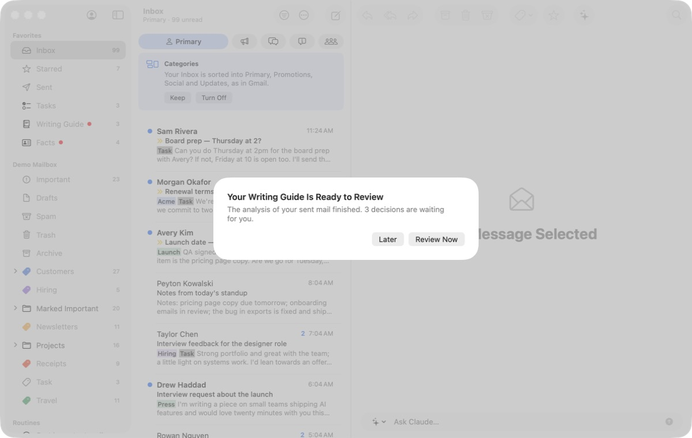
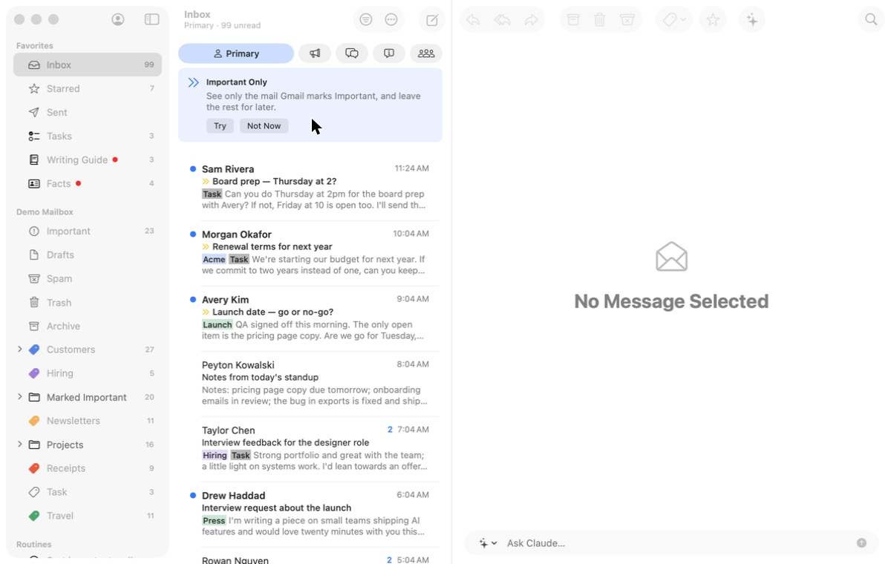
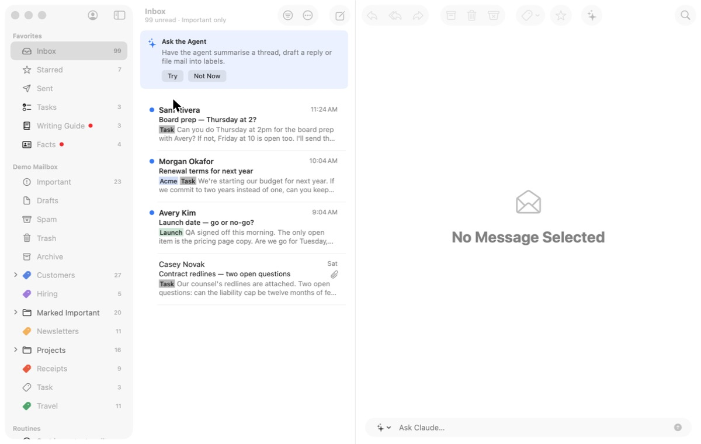
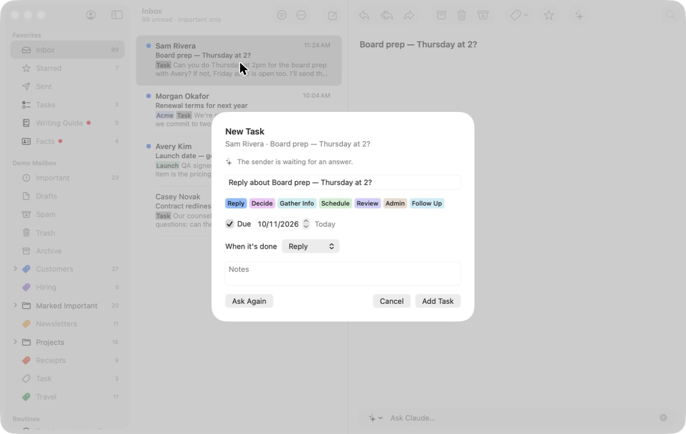
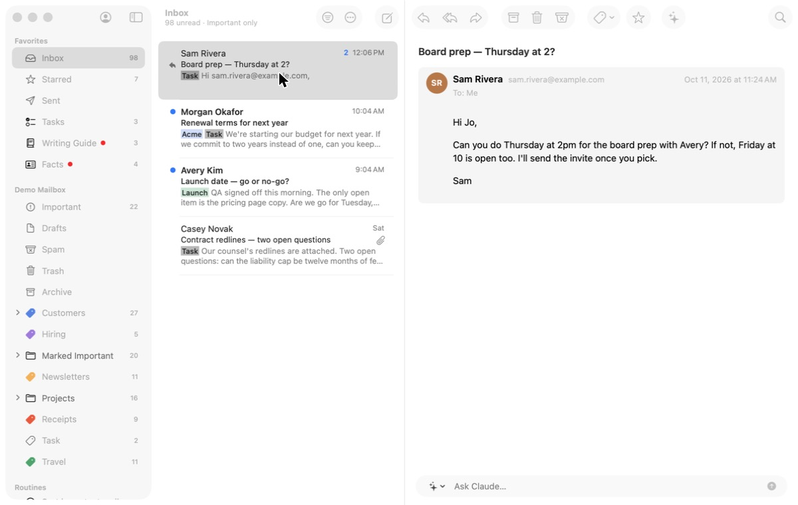
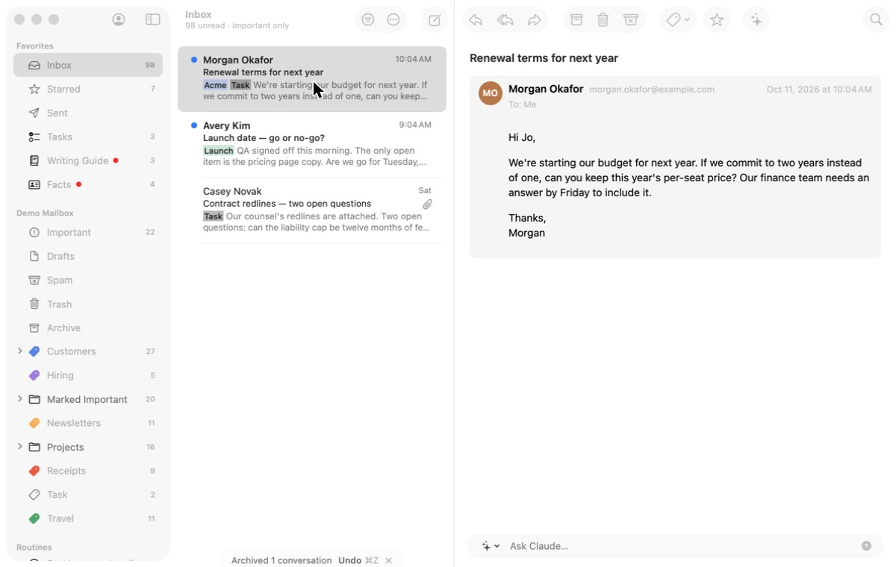

# 1. Triage what's new

**Job.** Decide each new conversation: reply, make a task, archive, or
leave it. **Done when** everything new has a decision.

## Walked

1. Launch. A modal: "Your Writing Guide Is Ready to Review" (Later /
   Review Now). 
2. Later. The Inbox shows a Categories tip (Keep / Turn Off). Keep.
3. An Important Only tip replaces it (Try / Not Now).
   
4. Try. Important Only shows four conversations under "99 unread ·
   Important only", and an Ask the Agent tip (Try / Not Now).
   
5. Not Now. Four dismissals in, the first email can be read.
6. Select Sam Rivera's "Board prep — Thursday at 2?", press `t`. A sheet
   proposes "Reply about Board prep — Thursday at 2?", Reply, due today,
   with Claude's why. The conversation already has the task "Pick a time
   for board prep"; the sheet does not say so. The sheet covers the
   email. 
7. Cancel; press `r`. The reply opens in its own window (task 2). Send.
8. Back in the main window the conversation is still in the Inbox, now
   with a replied arrow; its task is still open; the main window shows
   no sign the message went. 
9. Press `e`. "Archived 1 conversation — Undo ⌘Z", and the next
   conversation is selected. 

## Findings

- **Four interruptions before the first decision**, each about a feature
  rather than the mail. The modal also blocked *Quit* (see the README).
- **No boundary for "new".** Primary lists today's mail and weeks-old
  unread mail in one run; nothing counts what arrived since the user last
  looked or what is left to decide. Important Only narrows the list but
  keeps the Inbox's count ("99 unread") over four rows.
- **Replying does not finish the decision.** After sending, the
  conversation stays in the Inbox and its task stays open; the user must
  come back to the main window, archive, and later complete the task in
  Tasks.
- **`t` does not know about existing tasks**, so a second task on the
  same conversation is one Return away.
- **Archive's auto-advance works** and is the model for every decision:
  act, acknowledge, next.
- New mail arriving during triage lands at the top of the list, above
  where the user is working, with no note of it; nothing interrupts, but
  nothing says it came either.

## For the workflow

One conversation at a time, from a set fixed when the workflow opens
("12 new since 8:40"); each arrives with Claude's suggested decision
(archive, task, reply with a draft ready) on Return; reply happens in
place and files the conversation when sent; `t` shows an existing task
instead of making another; mail that arrives waits for the end ("3 new
arrived while you worked"). Tips and the guide's modal wait until the set
is done.
