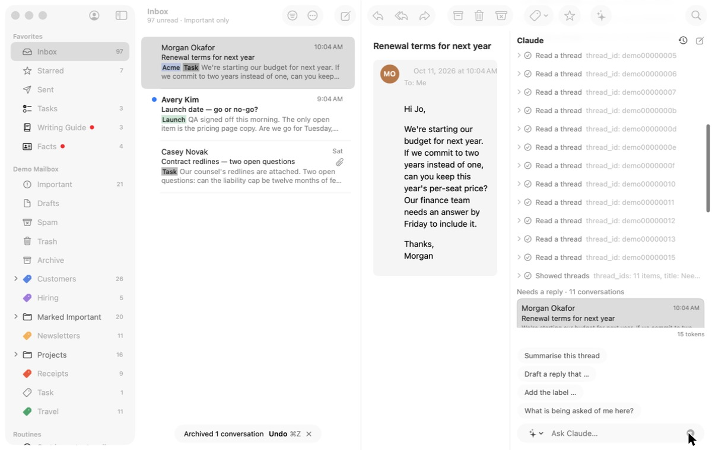
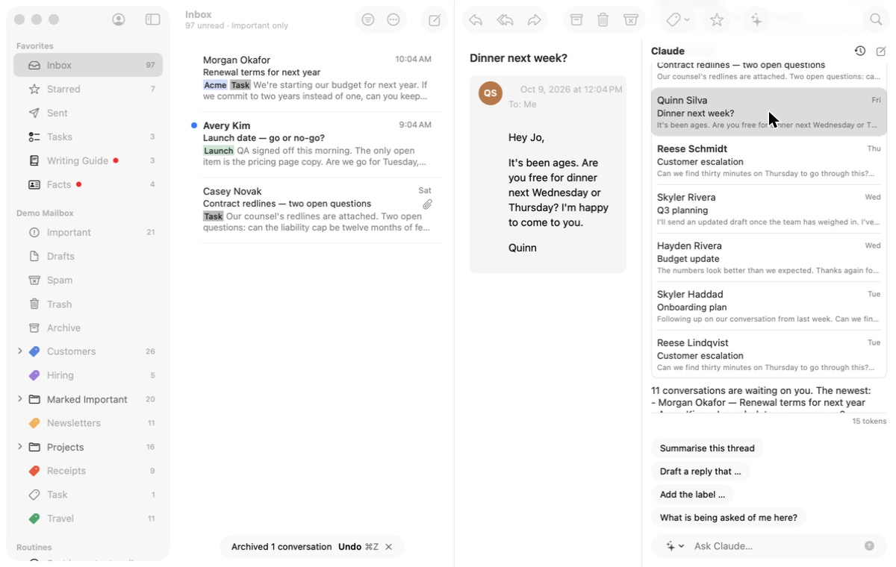
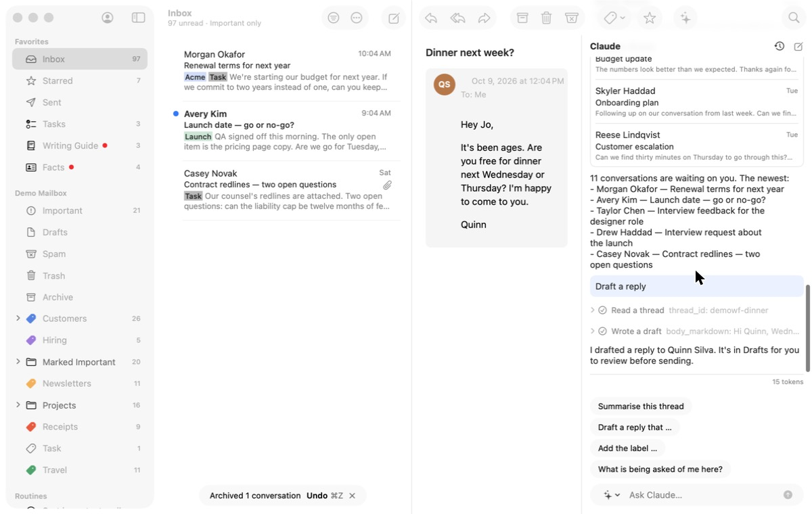
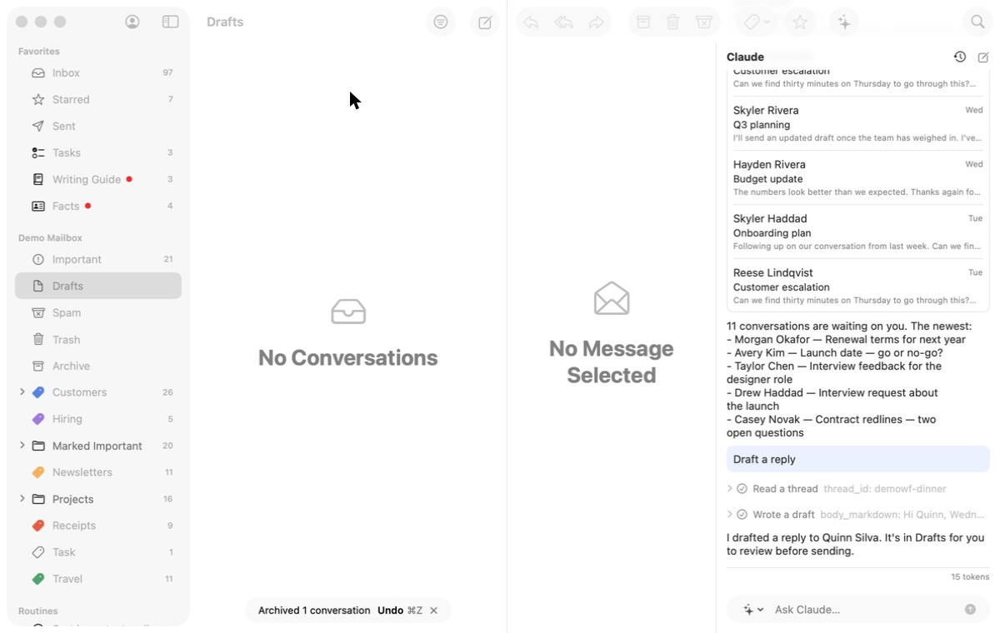
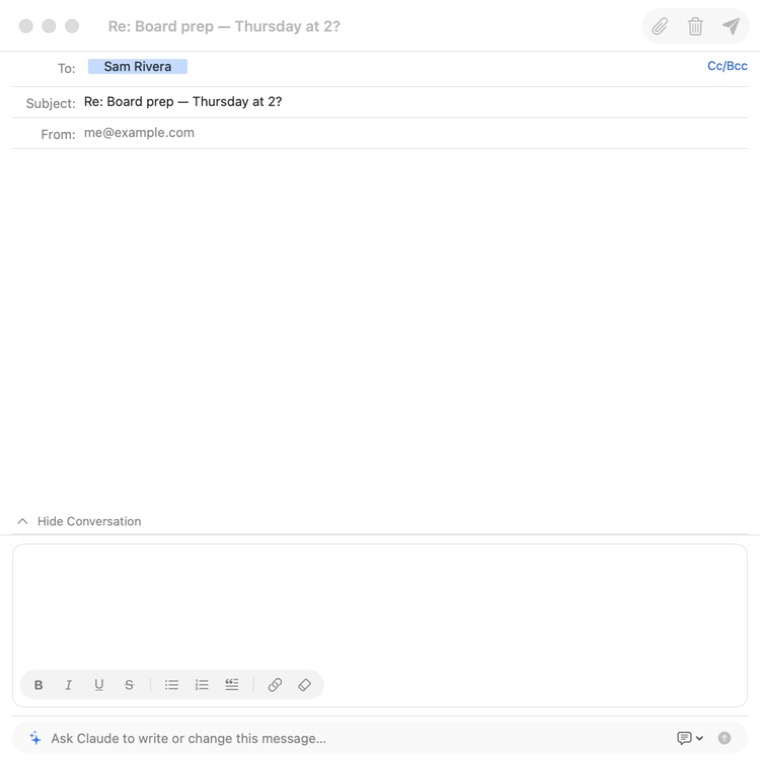
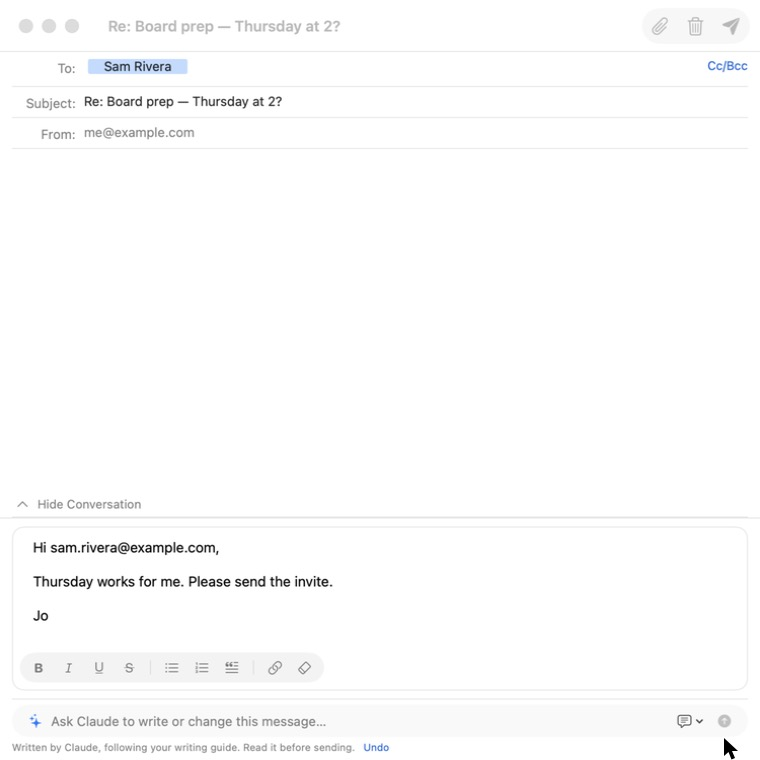

# 2. Answer what needs a reply

**Job.** Work through the conversations where someone waits on the user:
an AI draft in their style, edit, send, next. **Done when** the queue is
empty.

## Walked

1. In the Inbox, ask Claude "Which need a reply?". The agent column
   opens as a fourth column; the reader shrinks to about three words a
   line. The transcript shows a row per tool call; the answer, "Needs a
   reply · 11 conversations", is a box one row tall at the bottom.
   
2. Scroll the column to see the list; click Quinn Silva's "Dinner next
   week?". The reader shows it; the main list loses its selection.
   
3. Ask "Draft a reply". Claude reads the thread and writes a draft: "I
   drafted a reply to Quinn Silva. It's in Drafts for you to review
   before sending." The reader does not show it, no composer opens.
   
4. Open Drafts: "No Conversations". The draft exists as a local row
   (state *editing*); Drafts lists only drafts Gmail has, so it appears
   after sync on a real account and never in the demo, or offline.
   
5. The other path, from the Inbox: `r` opens a composer window; "Ask
   Claude to write or change this message…" writes the reply in place,
   marked "Written by Claude, following your writing guide. Read it
   before sending." with Undo; Send.
    
6. Earlier, "Draft a reply and send it" raised a real approval card ("Send
   'Re: Board prep — Thursday at 2?' to sam.rivera@example.com", Review /
   Reject / Approve); Reject reads "Declined" and the agent says the
   draft stayed in Drafts.

## Findings

- **The queue is not a queue.** It lives in one agent conversation; it
  has no next, nothing is checked off when answered, and it is gone when
  the conversation is.
- **The answer gets the least room.** Tool calls fill the column; the
  list is a one-row box; the reader is too narrow to read.
- **Agent drafts are hard to find** (step 4), and the agent's own words
  ("It's in Drafts") are not true until Gmail has synced it.
- **Two windows per reply.** The composer is a window of its own; after
  Send the user returns to the main window and to the agent column to
  pick the next.
- **Writing help is good**: one line, written in place, clearly marked,
  undoable. With a real model this is the wait in the loop (one model
  turn per draft); nothing prepares the next draft while the user edits
  this one.
- **The approval card is clear** and is the right size of decision.

## For the workflow

The list as the workflow's spine, not a chat answer: each conversation
in turn, the email and Claude's draft side by side at reading size, edit
in place, Send and the next arrives; drafts for the next items made while
the user edits this one; a count ("3 of 11"); sent conversations filed.
Agent drafts shown in their conversation (and in Drafts before Gmail has
them).
