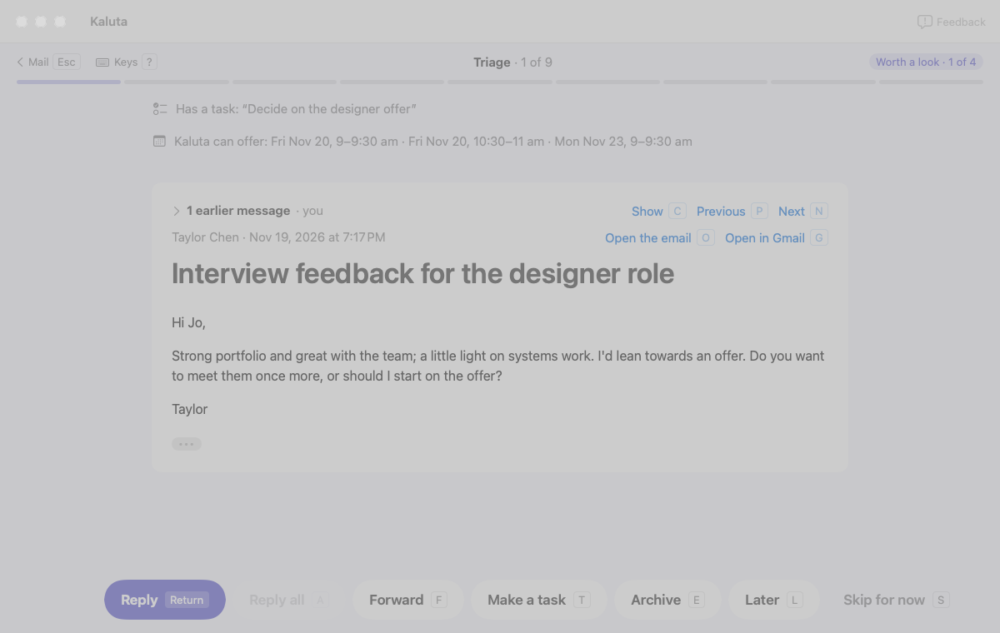

# 2. Triage what is new

**Where:** the Triage workflow; or the Inbox list in the mail window.

## How it goes today

**Workflow.** Return on the Dashboard. One conversation at a time, the
latest message at reading size, context lines above it ("Has a task",
free times), and seven actions: Reply (Return), Reply all (A), Forward
(F), Make a task (T), Archive (E), Later (L), Skip (S). Six more keys
are not on the bar (O, C, P, N, G, B). The header says where in the
set, and since 2026-11-19 which group ("Worth a look · 1 of 4"). One
key decides and the next conversation appears. Nine conversations:
nine keys if none needs writing.

**Mail window.** j/k or arrows move; e archives and selects the next
row; an undo notice stays 8 seconds. Nine conversations: nine keys too,
but without suggestions, groups, or an end.

## Findings

- **F8 (3). Kaluta's suggestion has no waiting or missing state.** The
  suggestion line and the marked button appear only once the
  background job has run. Before that, and with no agent ready,
  nothing is shown: the user cannot tell "Kaluta has no view" from
  "Kaluta has not looked yet" (`WorkflowHostView.swift:385`).
  Principles 7 and 14; AI guidelines 1 and 2.
- **F18 (2). Seven actions is more than "the few that apply".** Reply
  all and Forward are rare in triage and sit second and third, ahead of
  Make a task and Archive. Replies puts the same two at the far right.
  Principle 9.
- **F1 (3)** applies in the mail window: with Kaluta's column open the
  message being triaged is 250 points wide ([layouts.md](layouts.md)).
- **F17 (2).** In the mail window nothing marks which conversations are
  new since the user last looked, so triage there has no edge.

## What is good

One decision, one key, the key named on the button, Undo instead of a
confirmation, a count and an end. The group pill answers "what am I
looking at". This is the pattern the rest of the app should be
measured against.

## Against the reference patterns

An issue tracker's triage queue offers four numbered verdicts (accept,
decline, duplicate, snooze) and shows the assistant's suggestions on
the item as suggestions. Kaluta matches the second and exceeds the
first in number of actions; trimming the bar to the four that decide
(Reply, Make a task, Archive, Later) with the rest behind keys would
match it. A sender screener asks once per sender, not per message:
Kaluta has no equivalent for a first-time sender.
