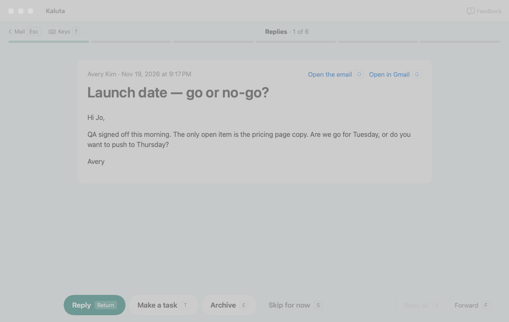
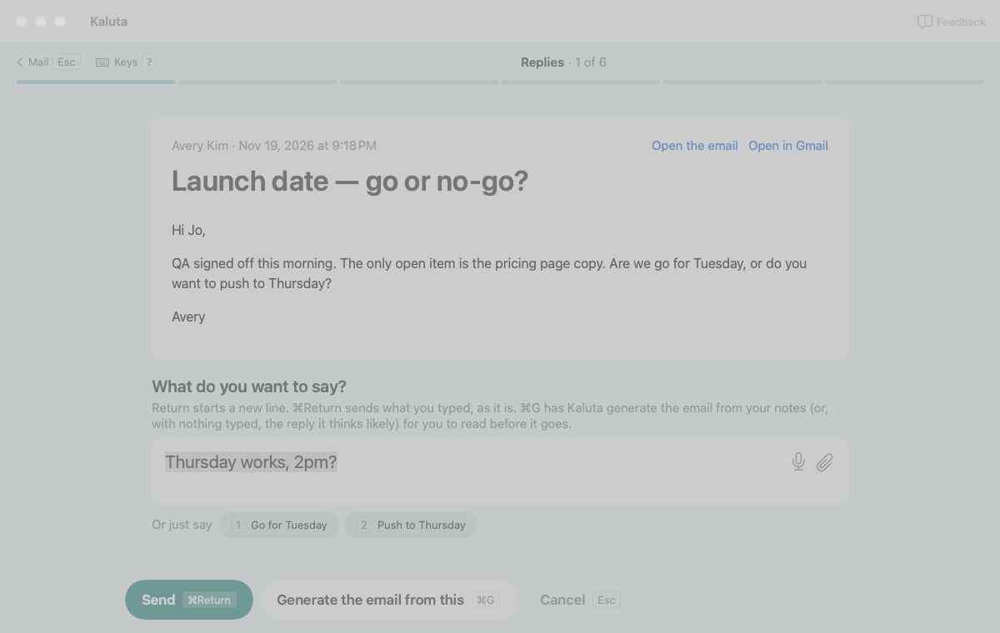
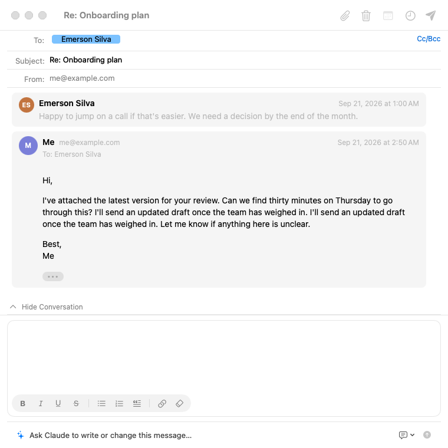

# 3. Answer what needs a reply

**Where:** the Replies workflow; or Reply in the mail window.

## How it goes today

**Workflow.** Return opens *What do you want to say?* (or the ready
answers on 1–3 when Kaluta has written some). The user types a few
words; ⌘Return sends them as typed, ⌘G has Kaluta write the email from
them, which then stops on an editable screen with ⌘Return to send. The
conversation is archived on sending. With a ready answer: Return, 1,
⌘Return — three keys.

**Mail window.** r opens a separate composer window with the
conversation above the text. ⇧⌘D or ⌘Return sends and closes it. The
conversation stays in the Inbox; archiving is another key back in the
main window.

## Findings

- **F6 (3). The same job ends differently in the two places.** A reply
  sent from a workflow archives the conversation; one sent from the
  mail window leaves it in the Inbox, and there is no *Send and
  Archive* there (`ComposerView.swift:60`). October's finding 5 is
  fixed in the workflows and still open in the mail window.
  Principle 9; heuristic 4.
- **F9 (2). The primary button sends notes as they are.** On *What do
  you want to say?* the filled button is *Send* (⌘Return) and *Generate
  the email from this* is secondary, yet the field invites notes
  ("Thursday works, 2pm?"). A user who expects Kaluta to write presses
  the obvious button and sends the notes. The rule is explained in a
  two-line paragraph that carries three key bindings. Heuristic 5.
- **F8 (3).** Replies shows no suggestion line at all; ready answers
  only change the button's title to "Reply · 3 answers ready".
- **F20 (2). Send is the faintest control in the composer:** a grey
  icon, fifth of five unlabelled icons. The platform asks for one
  prominent primary action.
- **F5 (3).** The composer's field reads "Ask Claude to write or change
  this message…" where the workflow says Kaluta ([09](09-rules.md),
  F5).

## What is good

Deciding that a reply is owed (Triage) is separate from writing it
(Replies), and the writing is batched: the reply-later pattern, done
well. Ready answers on 1–3 that become an ordinary editable draft match
the best of the references.

## Against the reference patterns

A keyboard-first client uses one key for both "write this" and "change
the selection"; Kaluta has that (⌘J) in the composer but ⌘G in the
workflow: two keys for one idea. The reply-later stack shows every owed
reply on one page; Kaluta shows one at a time, which fits its own
principle and needs no change.
