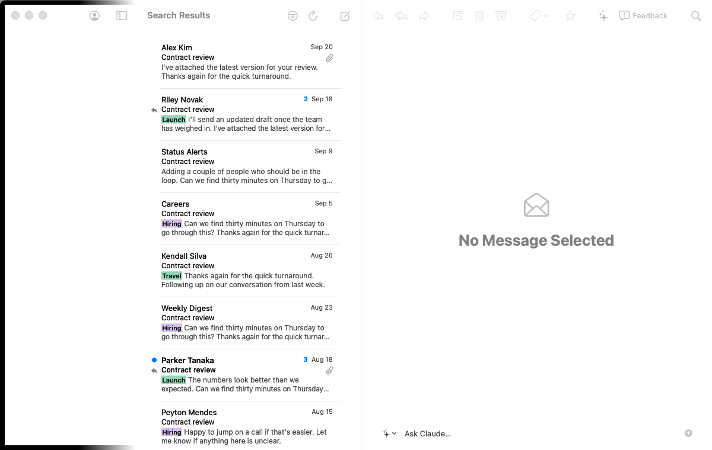

# 4. Find one conversation from last month and act on it

**Where:** the mail window. No workflow covers this.

## How it goes today

/ or ⌘F puts the cursor in the toolbar's search field; results replace
the list as the user types. Rows are ordinary thread rows. Matches by
meaning are added after the exact ones, each with a *Related* chip.
Older mail is fetched from the mail service with a line saying so.
Clearing the field leaves search.

## Findings

- **F13 (2). The results do not say what they are results for.** The
  list's title is "Search Results" with no query, count or scope, the
  matched words are not marked in the rows, and exact and *Related*
  matches run together in one list. There is no control to leave
  search; the field must be cleared. Heuristics 1 and 6.
- **F10 (2). Opening a result is heavier than it looks.** Selecting
  shows it in the reader; Return opens a new window; Space does
  nothing. There is no key to move from the list into the reader to
  scroll a long message.
- **F1 (3).** The reader's width, as everywhere in this window.
- **F12 (2). The toolbar is ten or more unlabelled icons** and cannot
  be customised (`MessageToolbar.swift`; no `.toolbar(id:)`). Archive,
  Trash and Junk sit side by side as three similar boxes.

## What is good

Search as you type over local mail, the fallback to the service for
older mail announced in words, operators that still filter, and the
palette (⌘K) reaching every mailbox and label.

## Against the reference patterns

The mail service's own filters let a search become a rule ("filter
messages like these"); Kaluta's search and its routines do not meet.
A native client for the same service offers a choice of key sets (the
platform mail app's or the service's); Kaluta supports both at once,
which is better, but does not say so anywhere but the key list.
