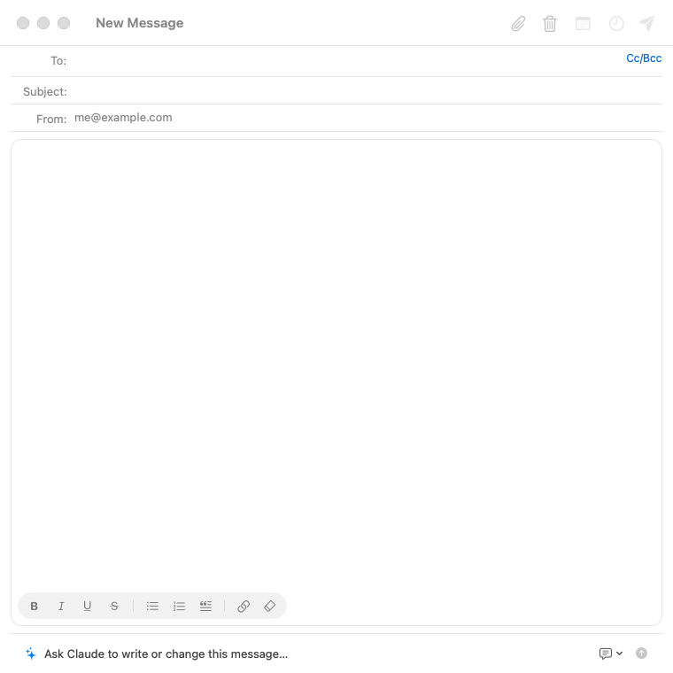

# 5. Write a new message, with and without Kaluta

**Where:** the composer window (c).

## How it goes today

c opens a composer window: To, Subject, From, the text, a formatting
bar, and a line at the bottom to ask for a draft or a change. `/` at
the start of a line inserts a snippet; ⌘J rewrites the selection;
⇧⌘D or ⌘Return sends; ⌥⇧⌘D sends later.

## Findings

- **F5 (3). The assistant here is called by its backend's name.** The
  field reads "Ask Claude to write or change this message…"; the same
  feature in a workflow is "Tell Kaluta what to say". Principle 17.
- **F20 (2). Send is not prominent** (see [03](03-replies.md)). Attach,
  Discard, a third icon, Send Later and Send are five grey
  icons of equal weight; Discard sits beside Send.
- **F11 (2). Recognition.** The icons have hover help but no labels,
  and Send Later is a clock with nothing to say it is a menu.
- **(2) Three ways to get help with the text** in one window: the
  bottom line (ask for a draft), ⌘J (rewrite the selection), and `/`
  (snippets). Each is good; nothing shows the three together or says
  which to use. The key hints footer used in pickers would do it.

## What is good

A draft written by Kaluta is marked as such until read, the user's
voice is named ("Your voice" opens the guide), and every AI-written
message stops on an editable screen before Send.

## Against the reference patterns

A keyboard-first client inserts stored text inline with one character
and opens a rewrite menu with one chord on the selection: Kaluta has
both. Inline completion accepted with Tab is the one writing aid the
references have that Kaluta does not; it is not obviously wanted.
