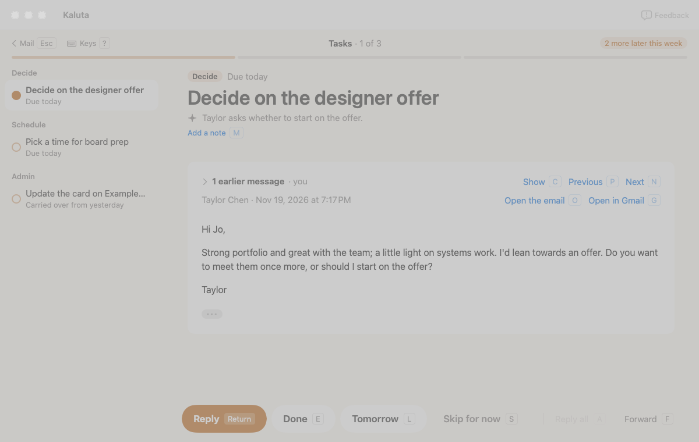
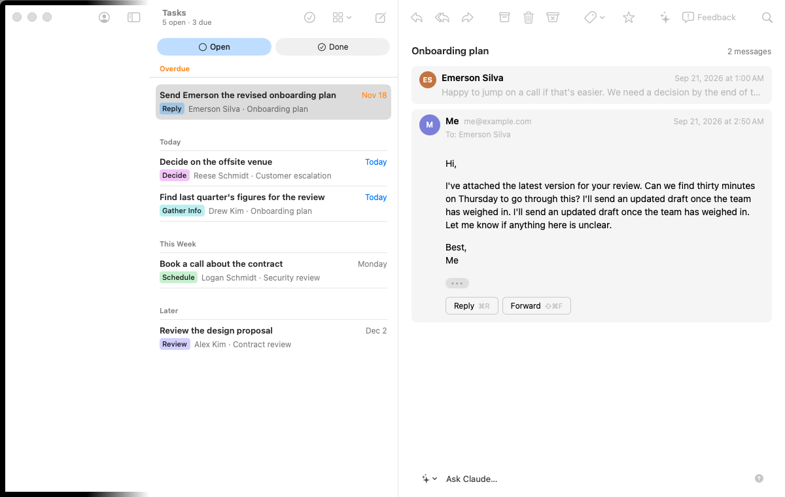

# 6. Work today's tasks; make a task from an email

**Where:** the Tasks workflow; the Tasks page in the mail window; t on
any conversation.

## How it goes today

**Workflow.** A rail lists today's tasks under their categories; the
task on screen shows its title large, Kaluta's one-line reason, a note
(M), and the email it came from. Reply (Return), Done (E), Tomorrow
(L), Skip (S).

**Page.** Open and Done tabs; sections Overdue, Today, This Week,
Later; a row is the title, a category chip, who and which conversation,
and the due day. Selecting a task shows its conversation in the reader.

**Making one.** t opens a dialog filled in by Kaluta (title, category,
due day, what completes it).

## Findings

- **(2) E means a different thing in each workflow:** Archive (Triage),
  Done (Tasks), Accept (Teach), Let it go (Waiting), Read (Reading).
  They share a sense ("finished with this"), which is defensible, but
  the bar never says so and the mail window's e is only Archive.
  Worth one sentence in the key list.
- **F5 (3).** The task dialog names the backend ("Ask Claude…") in four
  places (`TaskDialog.swift:164–199`).
- **(1) The Tasks page shows the conversation, not the task.** The
  reader holds the email; the task's own fields (what completes it,
  the note) are a dialog away. The workflow shows both together.
- **F1 (3).** The reader, as elsewhere.

## What is good

The page is the calmest list in the app: sections by when, a coloured
category chip, the due day at the right in the colour of its urgency.
The workflow's rail holds still while tasks are worked. Dates can be
typed in plain words.

## Against the reference patterns

A calm Today list opens a task in place, as a sheet of paper, with
fields hidden until needed: Kaluta's page opens the email instead and
its task opens as a dialog. Quick entry from anywhere that links the
current email is exactly t. A tracker's single menu acting on the
selection is ⌘K.
