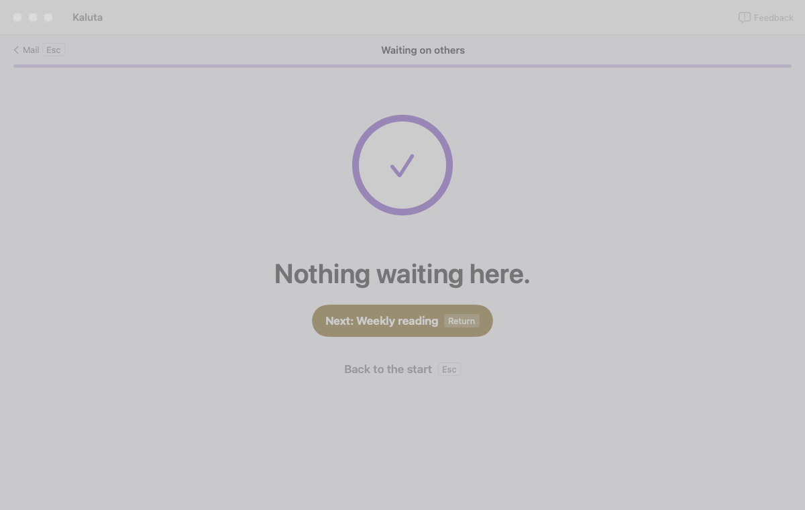

# 7. Check what is being waited on and chase one

**Where:** the Waiting on others workflow; *Tell Me When They Reply* in
the mail window.

## How it goes today

The workflow lists sent conversations with no answer after a few days,
the longest first, in a rail; for each: Nudge (Return), Let it go (E),
Check again (L), Skip (S). Nudge writes a short follow-up for the user
to read before it goes. A reply that arrives takes the conversation off
the list ("Answered · off the list"). In the mail window a conversation
can be watched, and a reply raises a notification with Reply and Remind
Me on it.

## Findings

- **(2) Waiting cannot be seen from the mail window.** A sent
  conversation the user is waiting on looks like any other; only the
  workflow knows. A quiet mark on the row ("waiting 4 days") would let
  the list answer the question too.
- **(2) Three near-identical ideas:** waiting (found by Kaluta), a
  watch (*Tell Me When They Reply*) and a reminder with *If no reply*.
  Each was built for a reason; the user is not told how they differ or
  which to reach for. Principle "one way to do each thing".
- **F8 (3).** Whether Kaluta has checked yet is not shown; an empty
  workflow reads "Nothing waiting here." in both cases.

## What is good

The end state is the model for the app: a ring, one sentence, the next
workflow on Return and the way back on Esc. A reply clearing the wait
without the user doing anything is the right kind of automatic.

## Against the reference patterns

A keyboard-first client's reminder is one key and a typed time; Kaluta
has that (b). None of the references finds unanswered mail by itself,
so here Kaluta is ahead; the gap is only in showing it outside the
workflow.
