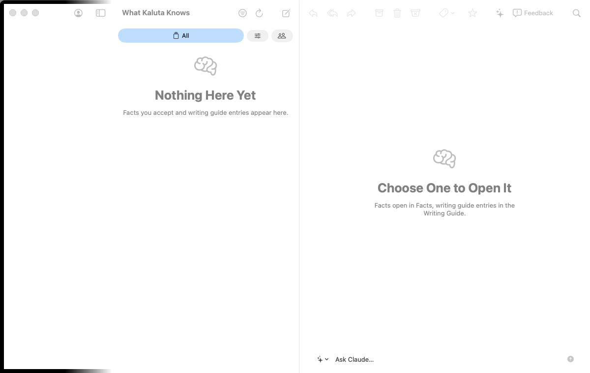
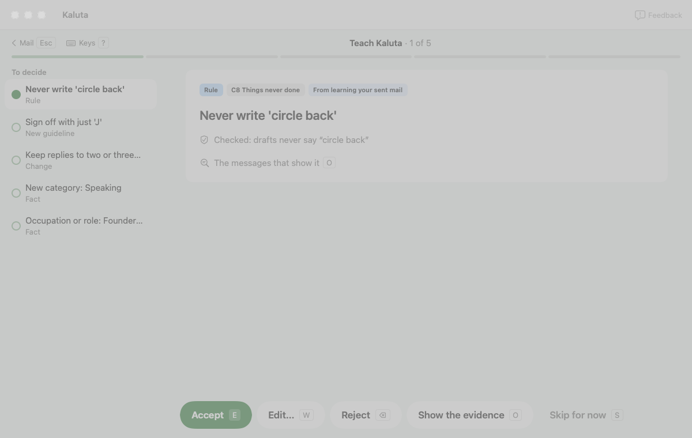

# 8. See what Kaluta knows about a person and correct one fact

**Where:** What Kaluta Knows, Facts and the Writing Guide (three sidebar
entries); Teach Kaluta for proposals.

## How it goes today

What Kaluta Knows lists facts and writing-guide entries together under
three tabs (All, Preferences, People), each row with its scope. It is
read-only: a click opens the row on the Facts page or in the Writing
Guide. On Facts, *Edit…* opens a dialog and *Delete* removes with
Undo. From the Inbox, deleting a fact is three clicks and editing one
is four. New facts and rules arrive as proposals in Teach Kaluta.

## Findings

- **F14 (3). Correcting what Kaluta knows takes three places.** The
  page that shows everything cannot change anything; the two that can
  are separate; none has search or a filter by person. To fix "what
  does Kaluta know about Taylor?" the user must find Taylor by eye
  under People, click through to Facts, then *Edit…*, then Save.
  Principle "one way to do each thing"; AI guideline 9 (efficient
  correction).
- **F11 (2). The tabs are icons until chosen** (a sliders icon for
  Preferences, two figures for People), as are the Inbox's category
  tabs, and neither set has keys. Heuristic 6.
- **(2) Nothing connects a person to their facts where the person
  appears.** Reading Taylor's email, there is no way to see what
  Kaluta knows about Taylor short of going to the page.
- **F22 (1).** "Nothing Here Yet" / "Choose One to Open It": title
  case, and the second names the page's limitation rather than
  inviting anything.

## What is good

Teach Kaluta is the right shape: one proposal at a time, its kind and
source as chips, the evidence a key away (O), Accept, Edit, Reject on
keys. Scope is shown on every row. Nothing is learned without the
user's yes.

## Against the reference patterns

Assistants' memory pages list what is remembered by topic and let each
entry be read, edited or deleted where it is; they also separate
*pause* (keep but do not use) from *reset*, and say at the moment of
saving that something was remembered. Kaluta's proposals are stronger
than a notice, but its page is weaker than theirs: read here, edit
there. A contact card shows only the fields that are filled and edits
in place: the model for a per-person view.
