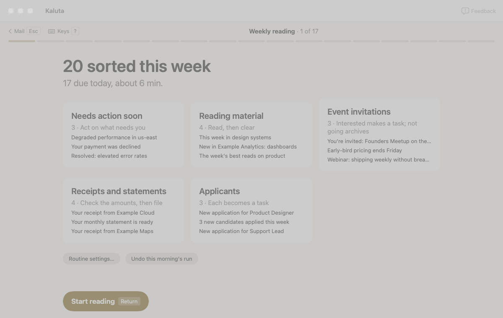

# 9. Read a sorting routine, change it, and undo a wrong filing

**Where:** the Routines window (⌥⌘R); Weekly reading; *Move to Inbox*
on a filed conversation.

## How it goes today

The Routines window lists routines as cards (name, one sentence built
from its buckets, the schedule in words, a switch). Editing is a form:
name, runner, schedule, scope, what to leave alone, then the buckets in
order, each with a label, title, colour, cadence and a *What belongs
here* text; or *Edit Prompt…*, which freezes the form. *Preview* sorts
without changing anything; *Run Now* runs once; *Publish* sends it to
the runner. A run can be undone whole. Moving one filed conversation
back to the Inbox says "Moved to the Inbox. Kaluta will propose a
change to the routine." with a field to say why; the proposal is
decided in Teach Kaluta.

## Findings

- **F15 (2). The routine reads as a sentence on its card and as a form
  when opened.** The sentence is the understandable version and it is
  the one that cannot be edited. A schedule can be an RRULE. Preview
  says where each conversation would go but not why (which bucket's
  words matched). Heuristic 2.
- **F5 (3). "Publish to Claude"** and the rest: the backend is named
  here by design (principle 17 allows it where the user chooses the
  runner), but the same name appears in about a dozen places where the
  user is simply asking Kaluta: the prompt under the reader ("Ask
  Claude…"), the column's heading, the toolbar tooltip, the menu item,
  the composer's field, the task dialog (`AgentStore.swift:101` is the
  one source). The workflows and the palette say Kaluta.
- **F21 (1).** In the reading report the third column's card sits ten
  points above the other two.
- **(2) A correction's effect is delayed and elsewhere.** The notice
  says so honestly, which is good; but the proposal lands in Teach
  Kaluta among other things, and nothing on the routine's card shows
  "1 correction waiting".

## What is good

*Correct it once* is the best idea in this area: fix it the obvious
way, say why if you like, undo with ⌘Z, and the rule changes only with
consent. Undo for a whole run. Preview before anything moves. The
weekly report shows what was sorted and how many, with the routine's
settings one click away.

## Against the reference patterns

A file-rule editor lets the user pick one real item and see, live,
whether the rule matches, with a tick or a cross on each condition and
the item's actual value on a click: that is the gap in Preview.
Automations that ask before running by default, with silent running
opted into per automation, match Kaluta's caution. Sorting that learns
from moving mail, with a page of what was learned, is *Correct it
once* plus Teach Kaluta. The mail service's filters can be made from
an example message; a routine cannot yet be started from "more like
this".
