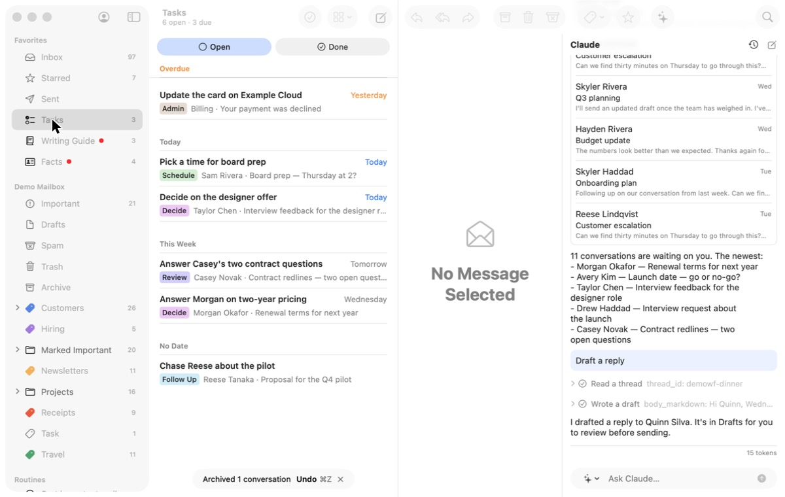
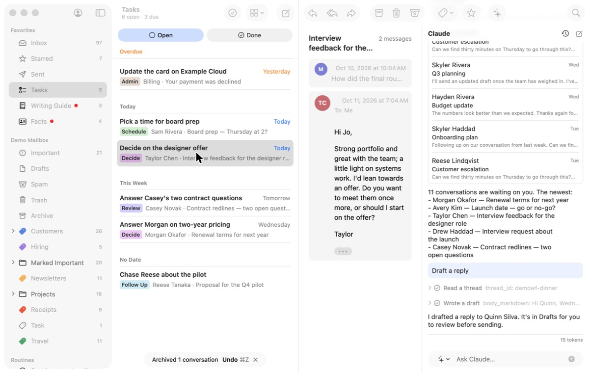
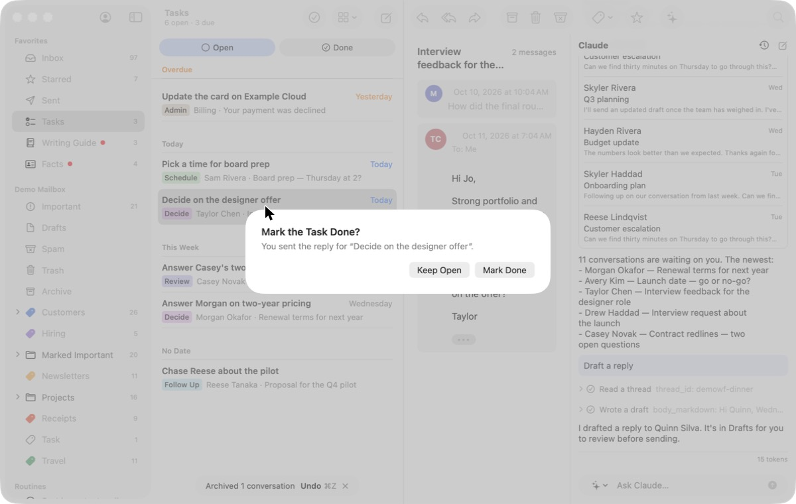
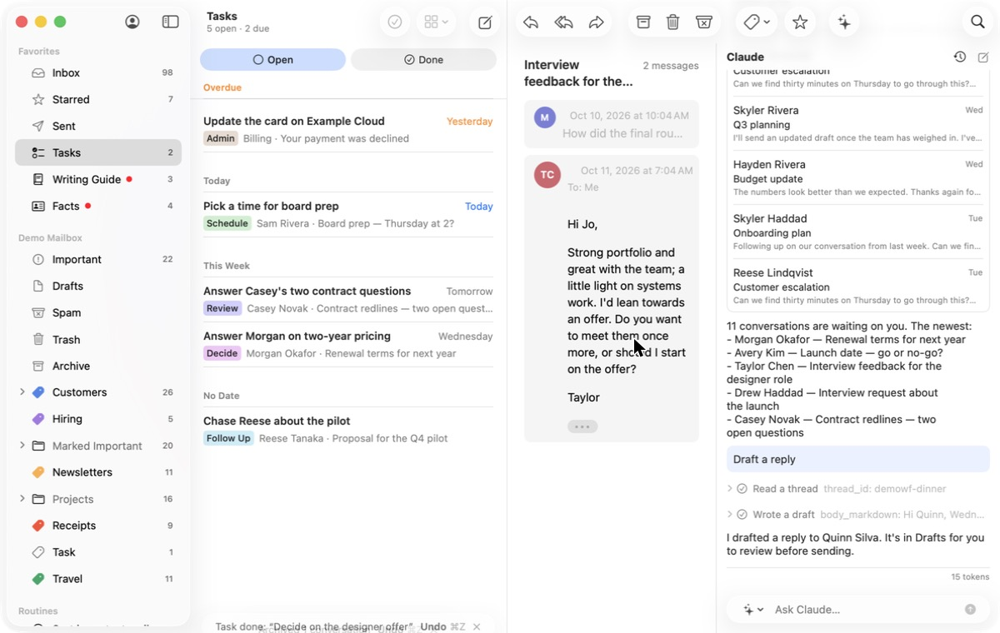

# 3. Work the task list

**Job.** Gather, decide, usually finish by replying. **Done when** today's
tasks are done.

## Walked

1. Tasks in the sidebar: "6 open · 3 due", grouped Overdue (the card
   update, "Yesterday" in orange), Today, This Week, No Date, each with
   its category chip and email. 
2. Select "Decide on the designer offer". The reader shows Taylor's
   email; the task itself (Claude's why, notes, due day) is not shown.
   Claude's column, still holding an earlier conversation, takes a third
   of the window. 
3. `r`: a composer window, with the conversation above; writing help;
   Send.
4. "Mark the Task Done? You sent the reply for 'Decide on the designer
   offer'." Keep Open / Mark Done. 
5. Mark Done: "Task done: … — Undo ⌘Z", clipped by the window's bottom
   edge; "5 open · 2 due"; the reader still shows the finished task's
   email; nothing is selected next. 

## Findings

- **The best list in the app**: grouped by when, overdue marked, counts
  that mean something.
- **The task is not on screen while working it**: only its email.
- **A confirmation dialog** after Send, where the design system says act
  and offer Undo; and only from here (a reply to the same email from the
  Inbox does not offer it, task 1).
- **No advance, no finish.** Completing a task leaves its email in view;
  the last task of the day ends the same way as the first.
- The undo notice is clipped at the bottom in this layout.

## For the workflow

Today's tasks as a set ("3 due"): the task (title, why, due) at reading
size above its email; the reply written in place; Send completes the task
and shows Undo, no dialog; the next task arrives; the set ends with a
score card (done today, still open, overdue cleared).
