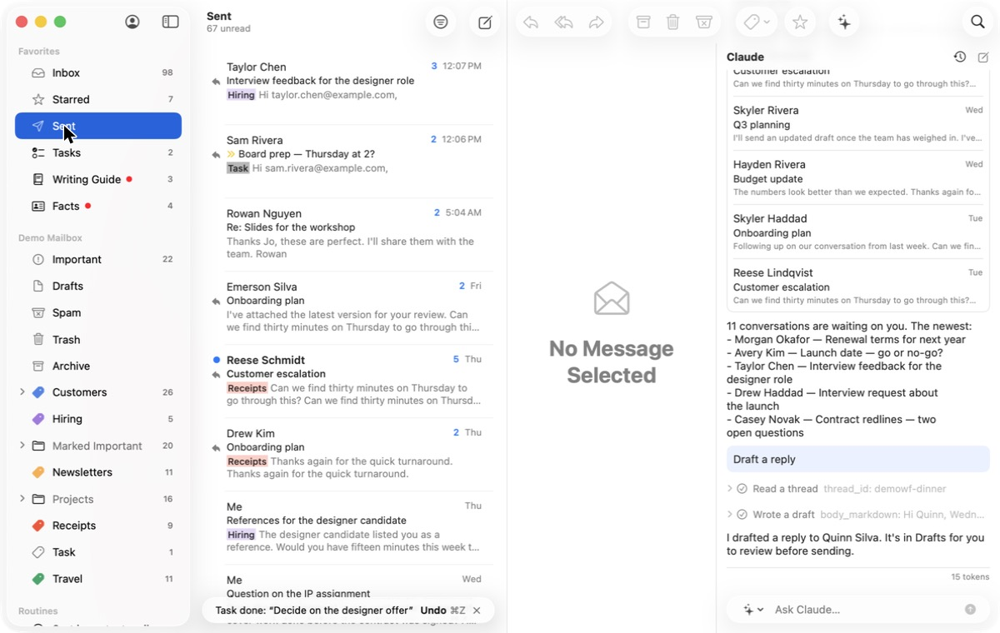
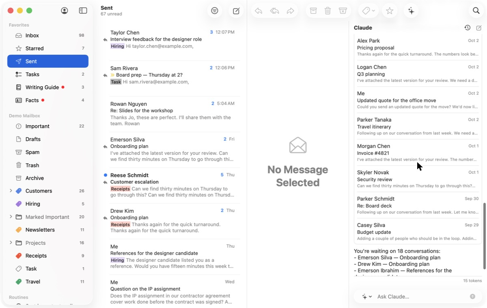

# 4. Chase what the user is waiting on

**Job.** Sent mail with no answer after a few days: nudge or drop.
**Done when** every overdue one is nudged or dropped.

## Walked

1. Sent: "67 unread". Conversations the user started show "Me" as the
   sender ("Me — References for the designer candidate"), not who they
   wrote to; answered and unanswered look alike.
   
2. Ask Claude "Who haven't I heard back from?". "You're waiting on 18
   conversations", a list whose rows again show "Me" for mail the user
   started, with no "waiting 6 days". 
3. A nudge is an ordinary reply: click, `r`, write, Send.

## Findings

- **No view for this job.** The app has no notion of "waiting on a
  reply"; only the agent can assemble it, and only for one conversation.
- **Rows name the wrong person** for this job, and do not say how long.
- "Unread" in Sent counts nothing the user needs.
- When the answer arrives (the demo's Reese reply), nothing connects it
  to the wait.

## For the workflow

A list kept by the app, not the agent: sent mail with no answer, by days
waiting, naming who owes it; per item Nudge (a short follow-up drafted in
the user's style, sent on approval), Drop (stop waiting), or Snooze;
an answer that arrives removes the item, and says so. Kept as a Gmail
label where possible (principle 1).
