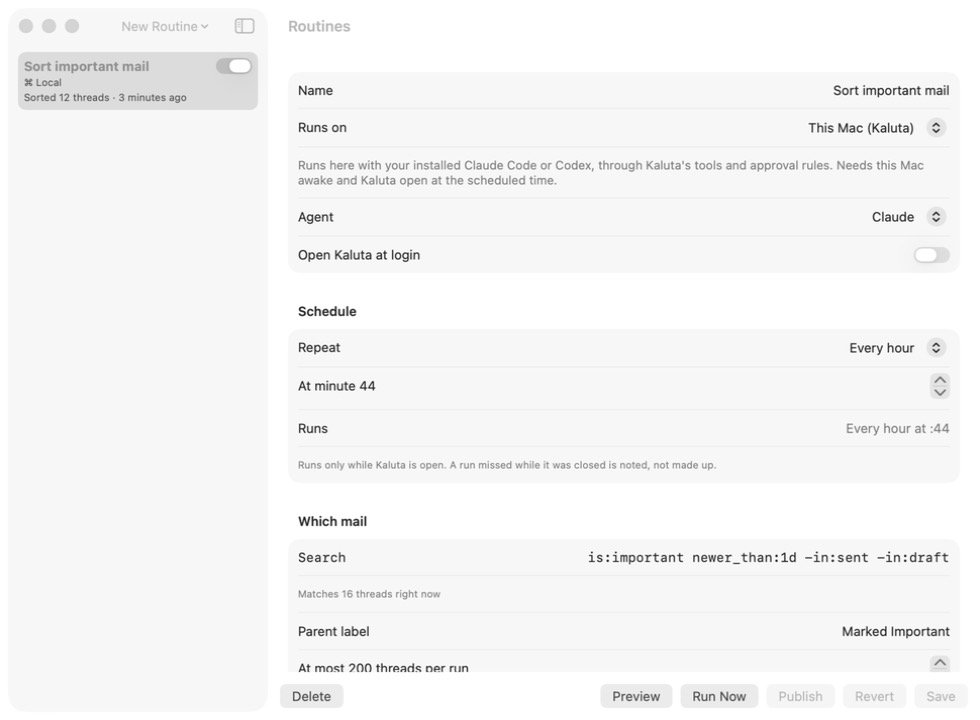
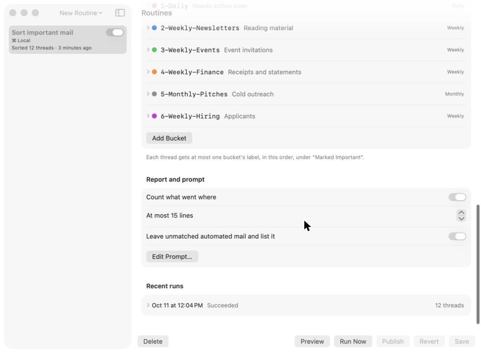
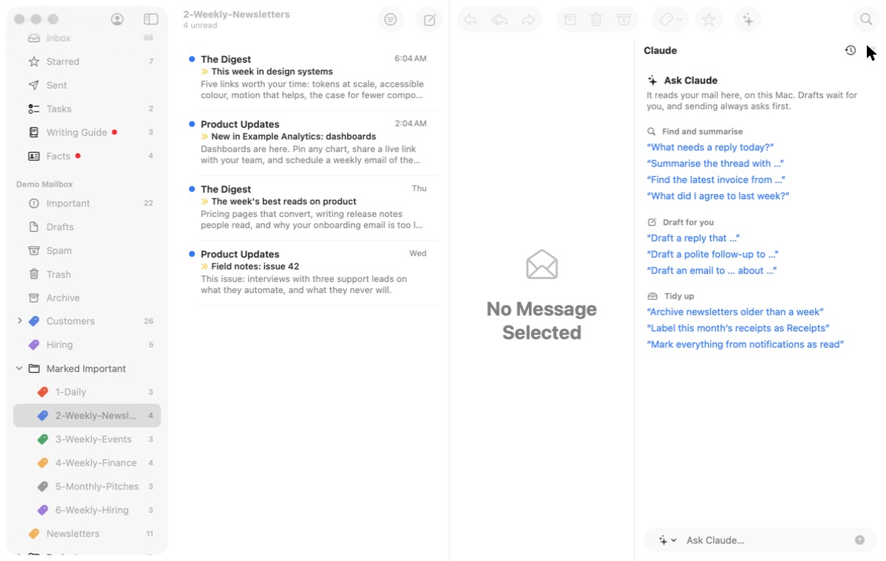
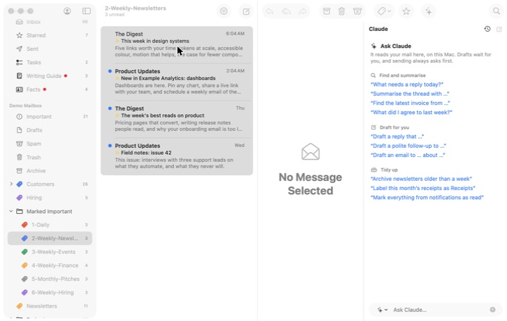

# 5. Skim the low-priority stream

**Job.** Read the routine's report and the automated mail it sorted;
clear the batch. **Done when** the batch is read or cleared.

## Walked

1. The sidebar's Routines section: "Sort important mail — Sorted 12
   threads · 3 minutes ago". Clicking it opens the Routines window on
   the routine's settings (runner, schedule, search, buckets).
   
2. The run's report is under *Recent runs*, at the bottom of the form,
   behind a disclosure.  (It did not
   open under background control; not counted as a finding.)
3. The mail: expand *Marked Important* in the sidebar; six labels, names
   truncated ("2-Weekly-Newsl…"). Open the newsletters label: four
   conversations, an ordinary list. 
4. Clear it: *Edit › Select All*. Four selected; the reader says "No
   Message Selected". 

## Findings

- **The report is a settings detail.** Getting from "Sorted 12 threads"
  to what was sorted goes through a configuration window.
- **The stream is six mailboxes**, read one row at a time, with nothing
  saying which are due (the labels are named by cadence, but nothing
  tells the user it is Friday and the weekly ones are ready).
- **Bulk clearing is invisible**: a multi-selection has no summary and
  suggests no action.
- The routine itself works: the 12 Important automated emails left the
  Inbox and landed in the right labels, and the run can be undone.

## For the workflow

A digest, not a mailbox: the report at reading size, then each due
bucket as a page of one-line summaries; skim with one key per item or
clear the bucket at once (archive and mark read, with Undo); the run's
Undo beside the report. The routine's settings stay in the Routines
window.
