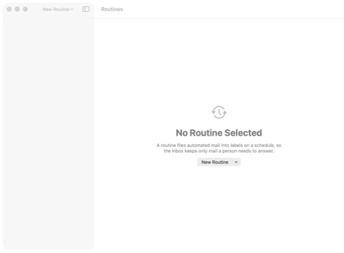
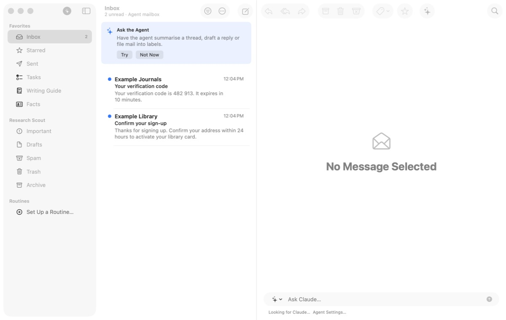
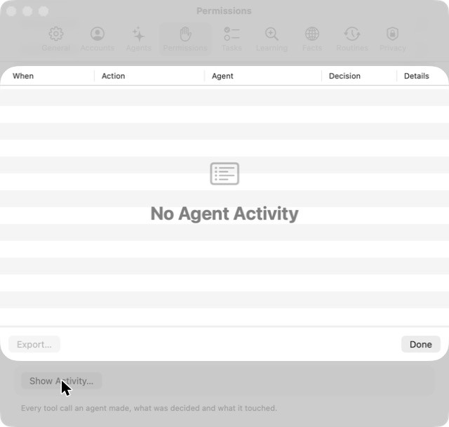

# 6. Check what agents did or want to do

**Job.** Approve or reject what waits, review agent drafts, keep or undo
routine runs, handle the agent mailboxes' mail. **Done when** nothing
waits on the user.

## Walked

1. Approvals: an approval card appears only inside the agent
   conversation that asked (task 2). Nothing outside it says one waits.
2. Agent mailboxes: *Kaluta › Accounts* lists "Research Scout —
   research-scout@demo.primitive.email (2)". The count is the only sign
   the agent got mail.
3. Choosing it **ended the app** (exit status 133, SIGTRAP; no crash
   report, nothing on stderr). Relaunched, the app restored only the
   Routines window, empty, with no mail window and no accounts in the menu
   until *Window › Mail*. 
4. Second try, under `lldb`: no crash. The agent mailbox shows the
   verification code and the sign-up confirmation, with the subtitle
   "Agent mailbox". 
5. The activity log: *Kaluta › Settings… › Permissions*, scroll, *Show
   Activity…*: a table (When, Action, Agent, Decision, Details), for the
   open account only; empty here, on the agent mailbox.
   
6. Routine runs: in the Routines window (task 5).

## Findings

- **A crash** on switching to an agent mailbox, not reproduced; worth an
  issue of its own.
- **Four places, none of them a queue**: approvals in transcripts,
  agent mail behind a menu, the log in Settings, runs in the Routines
  window. Nothing counts what waits on the user across them.
- **The log is an audit table**, per account, four levels deep.
- After the relaunch the agent bar kept reading "Looking for Claude…"
  although the agent was ready.

## For the workflow

One "Agents" workflow: everything waiting on the user in one set
(approvals, agent drafts, verification codes and sign-ups in agent
mailboxes, the latest routine runs), each with its decision (Approve,
Reject, Copy code, Keep or Undo run), and a count in the sidebar or the
start screen. The log stays in Settings for auditing.
