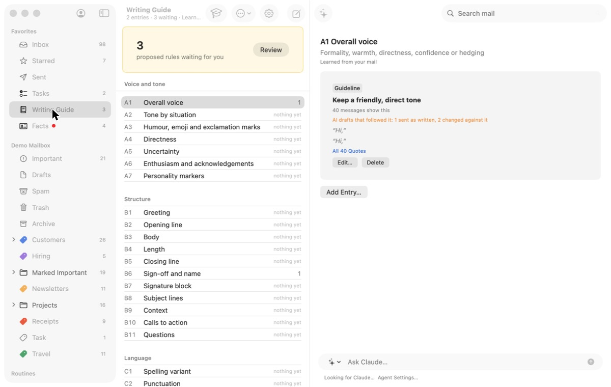
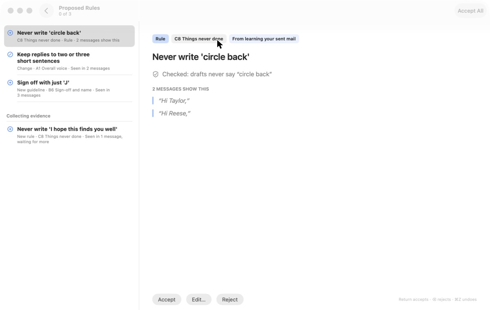
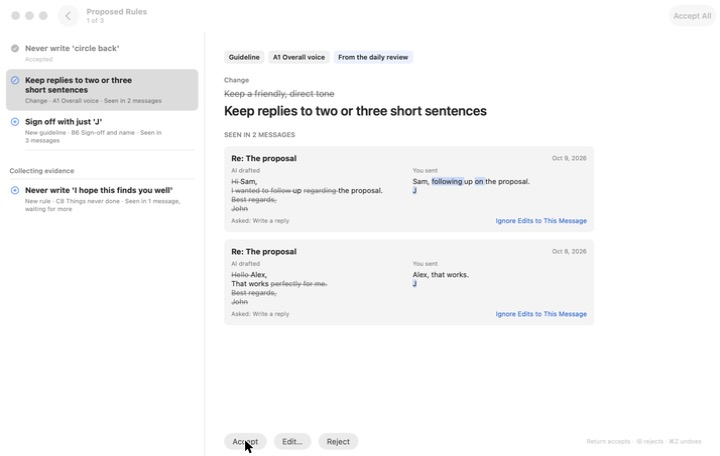
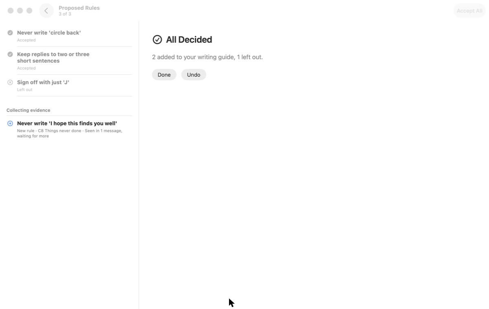

# 7. Teach it

**Job.** Decide the proposed rules and facts. **Done when** the queue is
empty.

## Walked

1. Writing Guide and Facts in the sidebar carry a red dot and a count.
2. Writing Guide: a band, "3 proposed rules waiting for you", the count
   in display type, Review. 
3. Review: the whole window. "Proposed Rules · 0 of 3"; the queue on the
   left with a *Collecting evidence* group; the statement large; the
   evidence quoted; Accept / Edit… / Reject; "Return accepts · ⌫ rejects
   · ⌘Z undoes". 
4. Accept: the next item, "1 of 3"; the first marked Accepted. A change
   shows what the AI drafted beside what the user sent, edits marked,
   with "Ignore Edits to This Message". 
5. Accept, Reject: "All Decided — 2 added to your writing guide, 1 left
   out", Done / Undo. 

## Findings

- **This is the workflow shape**, already built: one decision at a time,
  progress, keys on screen, evidence beside the decision, an end, Undo.
- **The end leads nowhere.** Facts has four proposals waiting; the end
  of rules does not offer them, and it plays no reward.
- The red dots are the only prompt, beside the launch modal (task 1).
- (The demo's rule "Never write 'circle back'" quotes "Hi Taylor,": the
  fake agent's evidence, not the app's.)

## For the workflow

Keep Review mode; make it one workflow over rules and facts together
("7 to decide"); end with the score (added, left out, still collecting)
and the next workflow; let the launch modal become an item on the start
screen instead.
